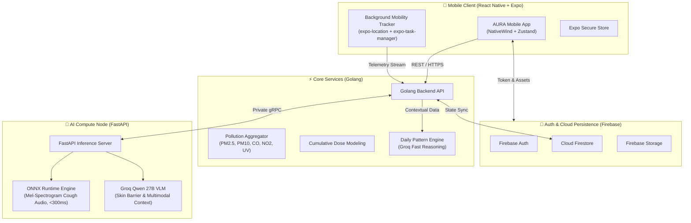

<p align="center">
  
</p>

<h1 align="center">AURA — AI-Powered Environmental Health & Mobility Companion</h1>

<p align="center">
  <strong>Platform Kesehatan Preventif Berbasis Mobile: Analisis Risiko Lingkungan Berdasarkan Aktivitas, Skrining AI Respirasi & Kulit, serta Mitigasi Adaptif Real-Time</strong>
</p>

<p align="center">
  <a href="#-tentang-aura"></a>
  <a href="#-tech-stack"></a>
  <a href="#-tech-stack"></a>
  <a href="#-tech-stack"></a>
  <a href="#-tech-stack"></a>
  <a href="LICENSE"></a>
</p>

<p align="center">
  
</p>

<p align="center">
  <a href="#-tentang-aura">Tentang AURA</a> •
  <a href="#-tujuan-pengembangan-platform">Tujuan Pengembangan</a> •
  <a href="#-arsitektur-sistem-terdistribusi">Arsitektur Sistem</a> •
  <a href="#-fitur-utama">Fitur Utama</a> •
  <a href="#-tech-stack">Tech Stack</a> •
  <a href="#-panduan-instalasi--menjalankan">Instalasi</a> •
  <a href="#-build-apk-release">Build APK</a>
</p>

---

## 🌟 Tentang AURA

**AURA** adalah platform kesehatan preventif berbasis mobile yang dirancang untuk melindungi masyarakat dan komuter urban dari ancaman polusi udara perkotaan serta cuaca ekstrem secara proaktif dan personal. 

Melalui perpaduan telemetri mobilitas hemat daya, agregasi polutan lingkungan makro dan hiperlokal, inferensi kecerdasan buatan (*AI Acoustic & Vision-Language Model*), serta ekosistem rujukan medis terintegrasi, AURA mentransformasi data lingkungan yang kompleks menjadi panduan kesehatan yang mudah dipahami, preventif, dan dapat ditindaklanjuti secara nyata.

---

## 🎯 Tujuan Pengembangan Platform

> **Visi Utama:**  
> *Mengembangkan platform kesehatan preventif berbasis mobile yang mampu menganalisis paparan risiko lingkungan harian komuter secara personal, menyediakan skrining dini kondisi respirasi dan kulit secara akurat, serta memberikan rekomendasi mitigasi yang adaptif.*

Rincian sasaran pengembangan teknis platform AURA terbagi ke dalam 6 pilar:

### A. Telemetri dan Pemodelan Dosis Paparan Personal
Mengembangkan sistem pelacakan mobilitas hemat daya berbasis **React Native** yang disinkronisasikan dengan mesin agregasi polusi $\text{PM}_{2.5}$, $\text{PM}_{10}$, $\text{CO}$, $\text{NO}_2$, dan indeks UV pada **backend Golang** untuk menghitung akumulasi dosis paparan harian (*Personal Cumulative Exposure Dose*) berdasarkan durasi kemacetan rute secara real-time.

### B. Pengembangan Inferensi Akustik Respirasi
Melatih model *deep learning* berbasis **Mel-Spectrogram** menggunakan **30.000 dataset audio batuk teranotasi** (200 epoch, ukuran batch 100) pada **PyTorch**, lalu mengekspornya ke format **ONNX** agar dapat dieksekusi via **ONNX Runtime** pada **FastAPI** dengan latensi inferensi di bawah **300 ms**.

### C. Model Multimodal Analisis Kerusakan Kulit
Mengintegrasikan *Vision-Language Model* **Qwen 27B** terakselerasi **Groq API** untuk mendeteksi eritema, kerusakan barier kulit, penuaan dini (*polluaging*), dan hiperpigmentasi melalui pengayaan *prompt* kontekstual yang memadukan citra visual dengan riwayat paparan polusi dan UV dari backend Golang.

### D. Analisis Pola Keseharian Pengguna (*Daily Pattern Engine*)
Mengimplementasikan integrasi **Groq API** pada backend Golang untuk menjalankan penalaran cepat (*fast reasoning*) terhadap data deret waktu (*time-series*) mobilitas harian, memetakan risiko rute rutin, serta menyajikan rekomendasi proteksi personal (standar filtrasi masker, jam aman komuter, dan protokol perawatan barier kulit).

### E. Rancang Bangun Arsitektur Terdistribusi Berkeandalan Tinggi
Membangun arsitektur *microservices* terpisah antara **server backend Golang** dan **server komputasi AI** (FastAPI / ONNX Runtime / Groq API) yang terhubung via **gRPC privat**, didukung ekosistem **Firebase** (Firebase Authentication, Cloud Firestore, Cloud Storage), serta aplikasi mobile modern berbasis **React Native**, **NativeWind**, **Zustand**, dan **Expo Secure Store**.

### F. Validasi Klinis, Uji Kinerja, dan Pengujian Pengguna
Mengevaluasi keandalan model AI menggunakan metrik standar (*Accuracy*, *Sensitivity*, *Specificity*, *F1-Score*, dan *AUC-ROC*), menjamin latensi alur komputasi *end-to-end* di bawah **3 detik**, serta melaksanakan *User Acceptance Testing* (UAT) pada komunitas komuter urban guna memvalidasi efektivitas proteksi mandiri.

---

## 🏗️ Arsitektur Sistem Terdistribusi



---

## ✨ Fitur Utama Aplikasi

### 1. 🌬️ Pemantauan Kualitas Udara Real-Time & Hiperlokal
* **Indeks AQI & Polutan Lengkap**: Menampilkan nilai AQI akurat, status polusi (Baik, Sedang, Tidak Sehat), tingkat $\text{PM}_{2.5}$, $\text{PM}_{10}$, $\text{CO}$, $\text{NO}_2$, suhu, kelembaban, serta indeks UV harian.
* **Peta Sebaran Polusi Interaktif**: Heatmap zona polusi di sekitar pengguna menggunakan Google Maps API dan geolokasi GPS real-time.
* **Rekomendasi Adaptif**: Mitigasi aktivitas luar ruangan personal berdasarkan ambang batas risiko lingkungan terkini.

### 2. 🫁 Skrining Akustik Respirasi Berbasis Deep Learning
* **Perekaman Audio Presisi**: Memanfaatkan modul `expo-audio` untuk merekam batuk atau hembusan napas secara jernih.
* **Inferensi Cepat (<300 ms)**: Pemrosesan Mel-Spectrogram audio via ONNX Runtime terlatih untuk mendeteksi indikasi ISPA, batuk kering polusi, atau eksaserbasi saluran pernapasan.
* **Laporan Diagnostik & Skor Risiko**: Skor keparahan gejala, saran hidrasi, dan panduan rujukan dokter pulmonologi.

### 3. 🔬 Skrining Kerusakan Dermal Multimodal (Qwen 27B VLM)
* **Pemindaian Kulit Kamera**: Akuisisi visual kondisi kulit wajah/lengan via `expo-camera` atau galeri foto.
* **Analisis Terkontekstualisasi**: Menggabungkan citra visual dengan riwayat kumulatif polusi dan indeks UV untuk mendeteksi eritema, kerusakan barier, dan penuaan dini (*polluaging*).
* **Rekomendasi Bahan Aktif**: Panduan bahan pelindung spesifik (Ceramide, Niacinamide, Sunscreen broad-spectrum).

### 4. 📍 Pelacakan Mobilitas & Dosis Paparan Kumulatif
* **Background Mobility Tracking**: Pemantauan rute komuter hemat daya di latar belakang (`expo-task-manager` + `expo-location`).
* **Personal Cumulative Exposure Dose**: Kalkulasi matematis paparan polutan yang dihirup sepanjang kemacetan rute harian.

### 5. 🏥 Jaringan Rumah Sakit & Reservasi Dokter
* **Direktori Faskes Terakreditasi**: Daftar faskes terdekat berdasar GPS dengan informasi jarak real-time, rating, dan fasilitas penunjang.
* **Peta Rute Navigasi Medis**: Navigasi polylines interaktif langsung menuju instalasi medis.
* **Reservasi Jadwal Dokter**: Konfirmasi booking konsultasi dokter spesialis paru dan kulit.

### 6. 🧴 Marketplace Kebutuhan Harian ("Kebutuhan Harian")
* **Katalog Produk Kurasi Perlindungan**: Sunscreen SPF 50+ PA++++, Masker KN95 5 Lapis, Ceramide Moisturizer, Botol Minum 750ml, Saline Nasal Spray, hingga Nebulizer Portabel.
* **Pencarian & Filter Cepat**: Filter kategori (*Anti panas*, *Anti polusi*, *Skincare*, *Pernapasan*), tab terlaris, dan sortir harga/rating.
* **Keranjang Belanja Dinamis**: Penyesuaian kuantitas item, kalkulasi otomatis subtotal rupiah, dan alur pemesanan langsung.

---

## 🛠️ Tech Stack

| Layer / Kategori | Komponen | Deskripsi & Peran |
| :--- | :--- | :--- |
| **Mobile Client** | React Native 0.86, Expo SDK 57 | Mobile framework lintas platform (Android & iOS) |
| **State & Security** | Zustand, Expo Secure Store | Manajemen state global terpusat dan penyimpanan kredensial terenkripsi |
| **Styling & UI** | NativeWind v4 (TailwindCSS) | Utility-first styling modern dengan palet warna Aura Design System |
| **Peta & Geolokasi** | `react-native-maps`, `expo-location` | Peta vektor Google Maps & GPS tracking real-time |
| **Sensors & Audio** | `expo-task-manager`, `expo-audio`, `expo-camera` | Pelacak background hemat baterai & perekam audio skrining |
| **Backend Core** | Golang (Go 1.22+) | Engine agregasi polutan, kalkulasi dosis paparan, & Daily Pattern Engine |
| **AI Inference Node** | FastAPI, Python 3.11 | Layanan inferensi berkecepatan tinggi terhubung via gRPC privat |
| **Respiratory AI** | PyTorch, ONNX Runtime | Model Mel-Spectrogram (30.000 dataset batuk, 200 epoch, latensi <300 ms) |
| **Dermal AI (VLM)** | Qwen 27B Vision via Groq API | Model multimodal penalaran visual & riwayat paparan polusi |
| **Cloud & Database** | Firebase (Auth, Firestore, Cloud Storage) | Autentikasi aman, basis data dokumen NoSQL, dan penyimpanan media |
| **Komunikasi Layanan** | Private gRPC & HTTPS/REST | Protokol komunikasi antar-layanan terdistribusi berlatensi rendah |

---

## 📁 Struktur Direktori

```text
AURA/
├── assets/                     # Aset logo, mockup aplikasi, foto medis, & produk
│   ├── Logo.png                # Logo resmi AURA
│   ├── MobileMockup.png        # Mockup antarmuka aplikasi AURA
│   ├── dr/                     # Foto dokter dan visual rumah sakit
│   ├── homepage/               # Banner dashboard dan ilustrasi polusi
│   └── products/               # Aset foto katalog kebutuhan harian
├── android/                    # Konfigurasi native Android (Gradle, CMake, CXX)
├── src/
│   ├── app/                    # Rute navigasi Expo Router (File-based)
│   │   ├── _layout.tsx         # Root layout, Stack navigator, font loader
│   │   ├── index.tsx           # Entry splash & onboarding
│   │   ├── dashboard.tsx       # Beranda utama (AQI, cuaca, peta, & banner aksi)
│   │   ├── kebutuhan-harian.tsx# Halaman belanja kebutuhan preventif harian
│   │   ├── lung-check.tsx      # Perekam suara respirasi & batuk AI
│   │   ├── lung-result.tsx     # Hasil diagnosis akustik & evaluasi paru-paru
│   │   ├── skin-check.tsx      # Pemindai kamera kesehatan dermal AI
│   │   ├── skin-result.tsx     # Hasil diagnosis barier kulit & rekomendasi
│   │   ├── pollution-impact.tsx# Analisis akumulasi dampak polusi personal
│   │   ├── ceksekarang.tsx     # Direktori faskes & dokter rujukan
│   │   ├── doctor-reservation.tsx# Alur booking jadwal konsultasi dokter
│   │   ├── hospital-detail.tsx # Detail faskes, fasilitas, dan jam operasional
│   │   └── hospital-route.tsx  # Navigasi polyline rute menuju rumah sakit
│   ├── components/             # Komponen UI modular
│   ├── constants/              # Token desain, palet AuraColors, & konfigurasi
│   ├── context/                # Context provider autentikasi & sesi
│   ├── data/                   # Data statis & mock rumah sakit/dokter
│   ├── services/               # Integrasi API, AI, Lokasi, dan Storage
│   │   ├── aiService.ts        # Klien inferensi AI respirasi & kulit
│   │   ├── backgroundMobilityTracker.ts # Tracking mobilitas hemat daya
│   │   ├── hospitalService.ts  # Layanan query faskes & rute GPS
│   │   ├── locationService.ts  # Manajemen izin & akuisisi GPS
│   │   └── zonesApi.ts         # Integrasi API pemetaan zona polusi
│   └── utils/                  # Helper formatting rupiah, waktu, & font
├── app.json                    # Manifest Expo, izin perangkat, & plugin native
├── package.json                # Manifest dependensi JavaScript / React Native
└── tailwind.config.js          # Konfigurasi utility Tailwind CSS
```

---

## 🚀 Panduan Instalasi & Menjalankan

### Prasyarat
* [Node.js](https://nodejs.org/) (versi LTS >= 20.x)
* [Bun](https://bun.sh/) (direkomendasikan) atau [npm](https://www.npmjs.com/)
* [Android Studio](https://developer.android.com/studio) dengan Android SDK (API 34/35) atau aplikasi [Expo Go](https://expo.dev/go) di smartphone fisik

### 1. Clone Repository
```bash
git clone https://github.com/username/AURA.git
cd AURA
```

### 2. Pasang Dependensi
```bash
bun install
# atau menggunakan npm:
npm install
```

### 3. Konfigurasi File Environment
Pastikan file `.env` telah dikonfigurasi dengan endpoint backend:
```env
EXPO_PUBLIC_API_URL=https://api.aura-health.app/v1
EXPO_PUBLIC_AI_API_URL=https://ai.aura-health.app/v1
```

### 4. Jalankan Server Pengembangan
```bash
bun start
# atau
npx expo start
```
* Tekan `a` untuk membuka aplikasi di Android Emulator / Perangkat Android yang terhubung via ADB.
* Tekan `w` untuk membuka versi web.
* Pindai QR Code dengan **Expo Go** pada perangkat fisik Android/iOS.

---

## 📦 Build APK Release (Android)

Untuk mengompilasi berkas APK Production secara mandiri via Gradle:

```bash
cd android
./gradlew assembleRelease
```

File APK siap rilis akan di-generate pada:
```text
android/app/build/outputs/apk/release/app-release.apk
```

> **Catatan Troubleshooting Build:**  
> Jika direktori repositori pernah dipindahkan, bersihkan cache autolinking Gradle terlebih dahulu:
> ```bash
> rm -rf android/build android/app/build android/app/.cxx android/.gradle
> ```

---

## 🧪 Validasi Kualitas Kode & Tipe

Proyek AURA menerapkan *strict type safety* untuk memastikan stabilitas aplikasi:

```bash
# Validasi tipe statis TypeScript (0 Error)
bunx tsc --noEmit

# Diagnosa dependensi dan kompatibilitas modul Expo
bunx expo-doctor
```

---

## 🔐 Izin Perangkat (Permissions)

AURA memerlukan izin berikut untuk menjalankan fitur perlindungan secara optimal:
* `ACCESS_FINE_LOCATION` & `ACCESS_COARSE_LOCATION`: Deteksi stasiun polusi hiperlokal dan estimasi jarak faskes.
* `ACCESS_BACKGROUND_LOCATION`: Pemantauan rute mobilitas komuter untuk kalkulasi paparan kumulatif.
* `RECORD_AUDIO`: Perekaman suara batuk untuk inferensi model akustik respirasi.
* `CAMERA` & `READ_MEDIA_IMAGES`: Pengambilan citra kondisi kulit untuk analisis dermal multimodal.

---

## 📄 Lisensi

Didistribusikan di bawah lisensi **MIT**. Lihat berkas [`LICENSE`](LICENSE) untuk detail lisensi.

---

<p align="center">
  Dibuat dengan ❤️ untuk menciptakan mobilitas perkotaan yang sehat dan lingkungan yang terlindungi bersama <strong>AURA</strong>.
</p>
