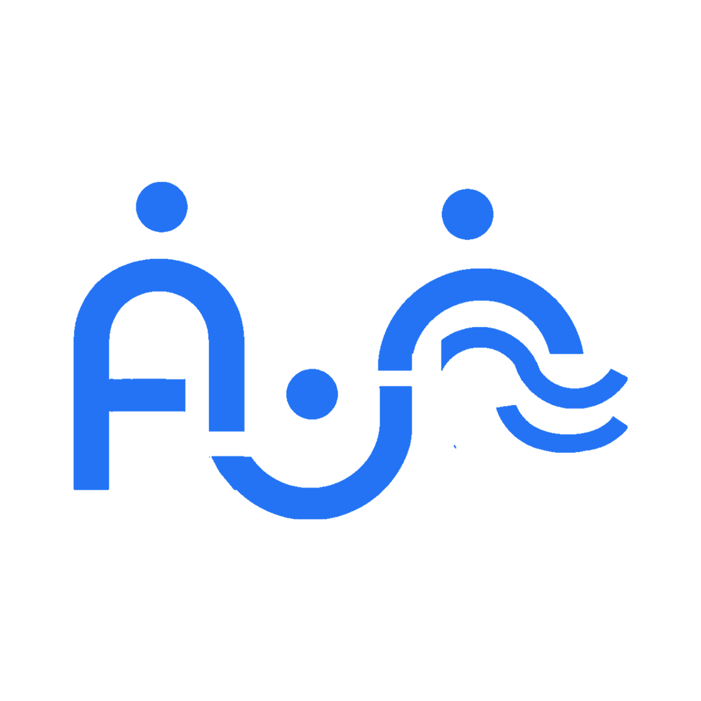
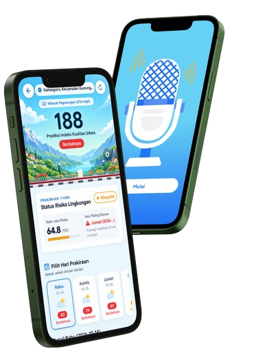

<p align="center">
  
</p>

<h1 align="center">AURA — AI-Powered Environmental Health & Mobility Companion</h1>

<p align="center">
  <strong>Solusi Cerdas Pemantauan Polusi Udara, Skrining Kesehatan AI, dan Mobilitas Sehat Real-Time</strong>
</p>

<p align="center">
  <a href="#-tentang-aura"></a>
  <a href="#-tech-stack"></a>
  <a href="#-tech-stack"></a>
  <a href="#-tech-stack"></a>
  <a href="#-tech-stack"></a>
  <a href="LICENSE"></a>
</p>

<p align="center">
  
</p>

<p align="center">
  <a href="#-tentang-aura">Tentang AURA</a> •
  <a href="#-fitur-utama">Fitur Utama</a> •
  <a href="#-arsitektur-aplikasi">Arsitektur</a> •
  <a href="#-struktur-direktori">Struktur Proyek</a> •
  <a href="#-instalasi--menjalankan">Panduan Instalasi</a> •
  <a href="#-build-apk-release">Build APK</a>
</p>

---

## 🌟 Tentang AURA

**AURA** adalah aplikasi mobile berbasis *React Native* & *Expo* yang dirancang untuk melindungi masyarakat dari bahaya polusi udara perkotaan dan cuaca ekstrem secara preventif dan proaktif. 

Dengan memadukan integrasi data sensor kualitas udara (*Air Quality Index / AQI*), pelacakan rute mobilitas hemat daya di latar belakang, algoritma kecerdasan buatan (*AI Multimodal*) untuk skrining paru dan kulit, serta jaringan rujukan rumah sakit terintegrasi, AURA menjadi asisten kesehatan harian yang komprehensif bagi Anda dan keluarga.

---

## ✨ Fitur Utama

```
                      ┌──────────────────────────────────────────────┐
                      │                 AURA CORE                    │
                      └──────────────────────┬───────────────────────┘
                                             │
      ┌──────────────────┬───────────────────┼───────────────────┬──────────────────┐
      ▼                  ▼                   ▼                   ▼                  ▼
┌───────────┐      ┌───────────┐       ┌───────────┐       ┌───────────┐      ┌───────────┐
│ Real-time │      │ AI Screen │       │ Mobility  │       │ Medical   │      │ Daily     │
│ Air & AQI │      │ (Skin/Lung│       │ Tracker   │       │ Partners  │      │ Needs     │
└───────────┘      └───────────┘       └───────────┘       └───────────┘      └───────────┘
```

### 1. 🌬️ Pemantauan Kualitas Udara Real-Time & Hiperlokal
* **Indeks AQI & Polutan**: Menampilkan nilai AQI akurat, status polusi (Baik, Sedang, Tidak Sehat), tingkat PM2.5, PM10, suhu, kelembaban, serta indeks UV harian.
* **Peta Sebaran Polusi Interaktif**: Visualisasi heatmap zona polusi di sekitar pengguna menggunakan Google Maps API dan geolokasi GPS real-time.
* **Rekomendasi Kesehatan Dinamis**: Rekomendasi aktivitas luar ruangan yang dipersonalisasi berdasarkan tingkat risiko polusi saat ini.

### 2. 🫁 AI Lung & Respiratory Health Check
* **Perekaman Suara Batuk & Pernapasan**: Memanfaatkan modul `expo-audio` untuk merekam batuk atau hembusan napas pengguna dengan kejernihan tinggi.
* **Analisis Akustik AI**: Mengidentifikasi indikasi gangguan saluran pernapasan seperti ISPA, batuk kering akibat polusi partikulat, atau batuk berdahak.
* **Hasil Diagnostik & Skor Risiko**: Memberikan tingkat risiko paru-paru, rekomendasi hidrasi, dan anjuran kapan harus menemui dokter spesialis pulmonologi.

### 3. 🔬 AI Skin Barrier & Dermal Screening
* **Pemindaian Kulit Kamera**: Mengambil gambar kondisi kulit wajah atau lengan secara instan via `expo-camera` atau galeri foto.
* **Deteksi Paparan Polusi Kulit**: Mengevaluasi kerusakan skin barrier, iritasi akibat radikal bebas polusi, jerawat polusi (*polluaging*), dan eritema UV.
* **Rekomendasi Bahan Skincare**: Saran kandungan bahan aktif (Ceramide, Niacinamide, Centella Asiatica, Sunscreen broad-spectrum).

### 4. 📍 Pelacakan Mobilitas & Paparan Kumulatif di Latar Belakang
* **Background Mobility Tracker**: Berjalan di latar belakang dengan konsumsi daya baterai sangat rendah (*low-power geofencing & activity recognition*) menggunakan `expo-task-manager` dan `expo-location`.
* **Kalkulasi Dosis Polusi Kumulatif**: Menghitung akumulasi polutan yang dihirup selama perjalanan harian (rute kerja/sekolah) dan memberikan peringatan jika melebihi ambang batas aman.

### 5. 🏥 Ekosistem Rumah Sakit & Reservasi Dokter
* **Direktori Rumah Sakit Terakreditasi**: Daftar faskes terdekat yang dilengkapi estimasi jarak (km), rating, fasilitas penunjang, dan jam operasional.
* **Navigasi Rute Medis**: Peta rute navigasi langsung menuju rumah sakit rujukan.
* **Reservasi Janji Temu Dokter**: Pemilihan jadwal dokter spesialis paru (*Pulmonologi*) dan kulit (*Dermatologi*) beserta konfirmasi instan.

### 6. 🧴 Marketplace Kebutuhan Harian ("Kebutuhan Harian")
* **Katalog Produk Kurasi Perlindungan**: Sunscreen SPF 50+ PA++++, Masker KN95 5 Lapis, Ceramide Moisturizer, Botol Minum 750ml, Saline Nasal Spray, hingga Nebulizer Portabel.
* **Filter & Pencarian Instan**: Kategori cepat (*Anti panas*, *Anti polusi*, *Skincare*, *Pernapasan*), tab terlaris, dan pengurutan harga/rating.
* **Keranjang Belanja Interaktif**: Manajemen kuantitas item, kalkulasi otomatis subtotal rupiah, dan konfirmasi pemesanan terpadu.

---

## 🛠️ Tech Stack

| Komponen | Teknologi | Keterangan |
| :--- | :--- | :--- |
| **Mobile Core** | React Native 0.86.3 | Framework inti multi-platform performa tinggi |
| **Tooling & Engine** | Expo SDK ~57 (Hermes) | Arsitektur modern dengan React Compiler aktif |
| **Routing** | Expo Router ~57.0.26 | File-based navigation berbasis direktori `src/app/` |
| **Language** | TypeScript ~6.0 | Strict type safety di seluruh layer data & UI |
| **Styling & Design** | NativeWind v4 + TailwindCSS | Utility-first styling dipadu palet warna Aura Theme |
| **Peta & Geolokasi** | `react-native-maps`, `expo-location` | Peta vektor Google Maps & GPS tracking real-time |
| **Background Task** | `expo-task-manager` | Pelacakan mobilitas & paparan latar belakang |
| **Media & Audio** | `expo-camera`, `expo-audio`, `expo-image` | Perekam suara AI dan pemindai kamera responsif |
| **Animasi & Gradien** | `expo-linear-gradient`, `react-native-reanimated` | UI modern, efek transisi halus & micro-interactions |

---

## 📁 Struktur Direktori

```text
AURA/
├── assets/                     # Aset gambar, ikon, dan mockup produk
│   ├── dr/                     # Foto dokter dan visual rumah sakit
│   ├── homepage/               # Banner dashboard dan ilustrasi polusi
│   └── products/               # Aset foto produk kebutuhan harian
├── android/                    # Konfigurasi native Android (Gradle, CMake, CXX)
├── src/
│   ├── app/                    # Rute navigasi Expo Router
│   │   ├── _layout.tsx         # Root stack navigator & font provider
│   │   ├── index.tsx           # Splash & landing entry point
│   │   ├── dashboard.tsx       # Beranda utama (AQI, rekomendasi, banner)
│   │   ├── kebutuhan-harian.tsx# Halaman kebutuhan harian & keranjang
│   │   ├── lung-check.tsx      # Skrining suara pernapasan & batuk
│   │   ├── lung-result.tsx     # Hasil diagnosis & laporan paru-paru
│   │   ├── skin-check.tsx      # Skrining kamera kesehatan kulit
│   │   ├── skin-result.tsx     # Hasil diagnosis dermal & rekomendasi
│   │   ├── pollution-impact.tsx# Analisis paparan dampak polusi
│   │   ├── ceksekarang.tsx     # Mitra faskes & dokter rujukan
│   │   ├── doctor-reservation.tsx# Alur booking jadwal temu dokter
│   │   ├── hospital-detail.tsx # Detail faskes & fasilitas
│   │   └── hospital-route.tsx  # Peta rute menuju rumah sakit
│   ├── components/             # Reusable UI components
│   ├── constants/              # Tema warna (AuraColors) & konfigurasi
│   ├── context/                # AuthContext & Session management
│   ├── data/                   # Mock & static dataset (Hospitals, Doctors)
│   ├── services/               # Integrasi API, AI, Lokasi, dan Storage
│   │   ├── aiService.ts        # Layanan inferensi AI (kulit & pernapasan)
│   │   ├── backgroundMobilityTracker.ts # Pelacak mobilitas background
│   │   ├── hospitalService.ts  # Layanan query faskes & rute GPS
│   │   ├── locationService.ts  # Manajemen izin & akuisisi GPS
│   │   └── zonesApi.ts         # Integrasi API zona AQI
│   └── utils/                  # Helper format rupiah, tanggal, dan font
├── app.json                    # Konfigurasi aplikasi Expo & permissions
├── package.json                # Dependensi modul npm/bun
└── tailwind.config.js          # Konfigurasi tema Tailwind CSS
```

---

## 🚀 Panduan Instalasi & Menjalankan

### Prasyarat
* [Node.js](https://nodejs.org/) (versi LTS >= 20.x)
* [Bun](https://bun.sh/) atau [npm](https://www.npmjs.com/)
* [Android Studio](https://developer.android.com/studio) dengan Android SDK (API 34/35) atau [Expo Go](https://expo.dev/go) di ponsel fisik

### 1. Clone Repository
```bash
git clone https://github.com/username/AURA.git
cd AURA
```

### 2. Pasang Dependensi
Proyek ini dioptimalkan menggunakan **Bun** (atau npm):
```bash
bun install
# atau menggunakan npm:
npm install
```

### 3. Konfigurasi File Environment
Salin file `.env.example` atau sesuaikan konfigurasi pada file `.env`:
```env
EXPO_PUBLIC_API_URL=https://api.aura-health.app/v1
EXPO_PUBLIC_AI_API_URL=https://ai.aura-health.app/v1
```

### 4. Jalankan Server Pengembangan
```bash
bun start
# atau
npx expo start
```
* Tekan `a` untuk membuka aplikasi di Android Emulator / Perangkat Android yang terhubung.
* Tekan `w` untuk menjalankan pada browser web.
* Pindai kode QR menggunakan aplikasi **Expo Go** di smartphone Anda.

---

## 📦 Build APK Release (Android)

Untuk menghasilkan binary **APK Production** secara lokal tanpa cloud build:

```bash
cd android
./gradlew assembleRelease
```

File APK siap pakai akan tersedia pada direktori:
```text
android/app/build/outputs/apk/release/app-release.apk
```

> **Catatan Pembersihan Cache (Troubleshooting):**  
> Apabila folder proyek pernah dipindahkan direktori, bersihkan cache Gradle terlebih dahulu dengan:
> ```bash
> rm -rf android/build android/app/build android/app/.cxx android/.gradle
> ```

---

## 🧪 Validasi Kualitas Kode & Tipe

AURA mematuhi standar kode ketat dengan TypeScript:

```bash
# Validasi tipe statis TypeScript (0 Error)
bunx tsc --noEmit

# Diagnosa dependensi dan kompatibilitas modul Expo
bunx expo-doctor
```

---

## 🔐 Izin Perangkat (Permissions)

AURA membutuhkan izin berikut untuk menyediakan fitur keselamatan proaktif:
* `ACCESS_FINE_LOCATION` & `ACCESS_COARSE_LOCATION`: Untuk mendeteksi stasiun AQI terdekat dan rute faskes.
* `ACCESS_BACKGROUND_LOCATION`: Memonitor paparan akumulasi polusi saat Anda bepergian.
* `RECORD_AUDIO`: Skrining akustik suara batuk pada fitur AI Lung Check.
* `CAMERA` & `READ_EXTERNAL_STORAGE`: Analisis visual kondisi kulit pada fitur AI Skin Check.

---

## 📄 Lisensi

Didistribusikan di bawah lisensi **MIT**. Lihat berkas [`LICENSE`](LICENSE) untuk informasi lebih lanjut.

---

<p align="center">
  Dibuat dengan ❤️ untuk lingkungan yang lebih sehat dan bernapas lebih lega bersama <strong>AURA</strong>.
</p>
